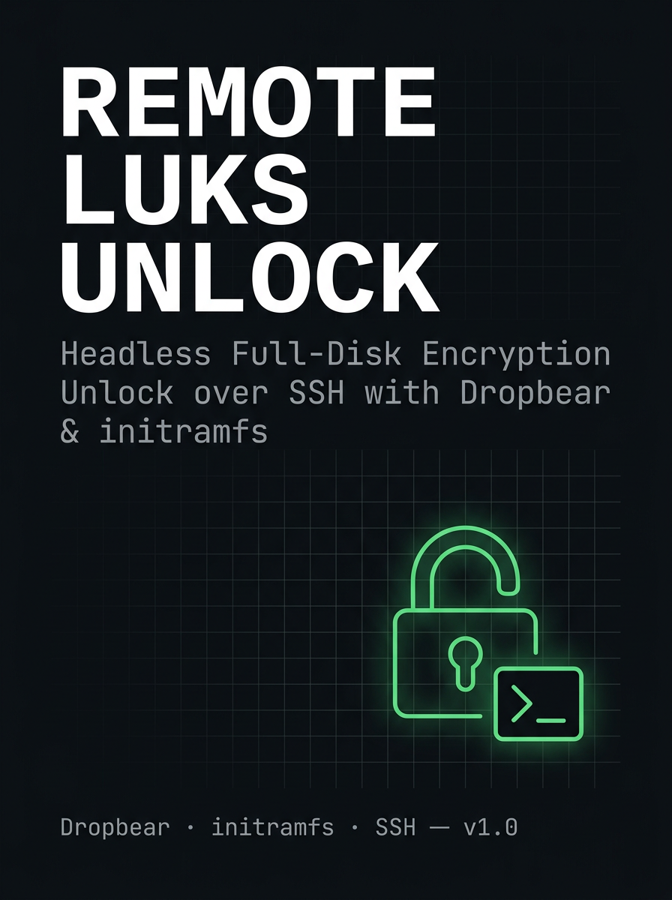

> Unlock your encrypted Linux server's disk over SSH — no monitor, no keyboard, no trip to the server closet.

**Difficulty:** Beginner–Intermediate · **Time:** ~30–45 minutes · **Distro:** Debian/Ubuntu (dropbear-initramfs)


---

> **This project does not claim ownership of Dropbear, cryptsetup, initramfs-tools, Ubuntu, Debian, or any other third-party software it documents.** Third-party software remains under its own original copyright and license terms — see [`THIRD-PARTY-NOTICES.md`](THIRD-PARTY-NOTICES.md). This repository's own license (see [License](#license) below) covers only the original documentation, scripts, and examples written for this guide.

---

## Why this exists

If you full-disk-encrypt a server with LUKS, you get real security — but you also create a new problem: **every reboot needs someone to type the passphrase at a physical keyboard**, because the encrypted disk can't be mounted (and your normal SSH server can't start) until that passphrase is entered.

For a homelab server tucked in a closet, garage, or another room, that's a dealbreaker. This guide sets up **Dropbear**, a tiny SSH server that runs *before* your disk is unlocked, so you can SSH in and type the passphrase remotely — from anywhere on your network.

**You do not need to be a Linux expert to follow this.** Every step explains *why*, not just *what to type*. If you're new to homelabbing, start with the [Concepts](#concepts-read-this-first) section before touching a terminal.

---

## Table of Contents

- [Who this is for](#who-this-is-for)
- [Prerequisites](#prerequisites)
- [Concepts (read this first)](#concepts-read-this-first)
- [Step-by-step setup](#step-by-step-setup)
- [Testing it](#testing-it)
- [Security notes](#security-notes)
- [Troubleshooting](#troubleshooting)
- [Going deeper](#going-deeper)
- [FAQ](#faq)
- [Tested versions](#tested-versions-reproducibility-record)
- [Resources & credits](#resources--credits)
- [Contributing](#contributing)
- [License](#license)

---

## Who this is for

- You have (or are building) a homelab server running Debian or Ubuntu
- Your root filesystem is encrypted with LUKS
- You don't want to physically walk over to it every time it reboots
- You're comfortable typing commands into a terminal, even if you don't know what all of them mean yet

**Not covered here:** setting up LUKS encryption itself (assumes it's already in place from your OS installer), or non-Debian/Ubuntu distros (Fedora/Arch/others use a different tool called `dracut` — see [FAQ](#faq)).

---

## Prerequisites

- [ ] A Debian- or Ubuntu-based server with LUKS-encrypted root, already installed and bootable
- [ ] Root/sudo access on that server
- [ ] A second computer on the same network to connect *from* (Windows, Mac, or Linux — any will do)
- [ ] The server's network cable connected (Wi-Fi generally isn't available this early in boot — use Ethernet)
- [ ] 30–45 minutes and the ability to reboot the server a couple of times

---

## Concepts (read this first)

**A normal boot** looks like: `power on → bootloader → kernel loads a temporary mini-filesystem (initramfs) → initramfs unlocks/mounts your real disk → your full OS and its normal SSH server start`.

The problem: your **real** SSH server lives on the disk you haven't unlocked yet. Dropbear solves this by living inside that temporary mini-filesystem instead — the one part of the process that isn't encrypted, since the computer needs to read it before any unlocking can happen.

Two things worth understanding before you start:

1. **Two separate SSH identities.** Dropbear (in initramfs) and your normal SSH server (in the full OS) are two completely different programs with different keys. Connecting to one tells you nothing about the other — this is expected, not a bug.
2. **Public vs private keys.** You'll generate a keypair on your own computer. The **private** key never leaves your computer. Only the **public** key (the `.pub` file) gets copied to the server. If you remember one rule: *private stays home, public travels.*

---

## Step-by-step setup

### 1. Reserve a static IP for the server (recommended)

Do this in your router's admin page, not on the server. Find your server's MAC address:

```bash
ip link show <your-network-interface>
```

(Not sure of your interface name? Run `ip a` and look for the one with an IP address that isn't `lo`.)

Then, in your router's settings, find **DHCP reservation** / **static lease** / **address reservation** (naming varies by router brand) and bind that MAC address to a fixed IP. This keeps the server's address from changing, which matters because you'll hardcode it in a later step.

### 2. Install Dropbear

```bash
sudo apt update
sudo apt install dropbear-initramfs
```

> **Path note:** `/etc/dropbear/initramfs/` is the correct location on **Debian 12+ and recent Ubuntu (roughly 23.04+)**. Older releases keep everything under `/etc/dropbear-initramfs/` instead — if that directory exists and the other doesn't, use it everywhere this guide says `/etc/dropbear/initramfs/`. The file names and file contents are identical either way. Check which one you have:
>
> ```bash
> ls -d /etc/dropbear/initramfs /etc/dropbear-initramfs
> ```

This also installs `initramfs-tools`, the tool that actually builds the mini-filesystem. You'll see host SSH keys generated automatically, and a warning like:

```
dropbear: WARNING: Invalid authorized_keys file, SSH login to initramfs won't work!
```

**This is expected** — you haven't authorized any key yet. That's next.

### 3. Generate a dedicated key on your own computer

```bash
ssh-keygen -t ed25519 -f ~/.ssh/myserver_unlock
```

This creates `myserver_unlock` (private — stays on your computer) and `myserver_unlock.pub` (public — goes to the server). Use a dedicated key, not your everyday one — if it's ever compromised, it can only ever trigger a disk unlock, nothing else.

### 4. Authorize that key on the server

View the public key so you can copy it:

```bash
cat ~/.ssh/myserver_unlock.pub
```

On the server, create the authorized_keys file (it does not exist by default):

```bash
sudo nano /etc/dropbear/initramfs/authorized_keys
```

Paste the full line, exactly as printed, restricted so it can *only* trigger the unlock — never a full shell:

```
no-port-forwarding,no-agent-forwarding,no-x11-forwarding,command="/bin/cryptroot-unlock" ssh-ed25519 AAAA...your-key-here... myserver-unlock
```

> ⚠️ **This one line is the easiest place to make a mistake.** See the [line syntax breakdown](#a-note-on-line-syntax) below before saving.

Save, then lock down the file:

```bash
sudo chmod 600 /etc/dropbear/initramfs/authorized_keys
```

#### A note on line syntax

This must be **one single unbroken line** with precise spacing:

| Part | Example | Separator to next part |
|---|---|---|
| Restrictions (comma-joined, **zero spaces**) | `no-port-forwarding,no-agent-forwarding,no-x11-forwarding,command="/bin/cryptroot-unlock"` | **one space** |
| Key type | `ssh-ed25519` | **one space** |
| Key data | `AAAA...` | **one space** |
| Comment (optional) | `myserver-unlock` | end of line |

If it visually wraps on your screen, that's fine — that's word-wrap, not a real line break. Never press Enter in the middle of it. Always copy-paste the key data; never retype it.

### 5. Set Dropbear's runtime options

```bash
sudo nano /etc/dropbear/initramfs/dropbear.conf
```

```
DROPBEAR_OPTIONS="-p 2222 -s -j -k -I 60"
```

- `-p 2222` — listen on a different port than your normal SSH (port 22), so the two never get their keys confused in your `known_hosts` file
- `-s` — key-only login, no passwords
- `-j -k` — disable port forwarding through this session
- `-I 60` — auto-disconnect after 60 seconds idle

### 6. Set a static IP for the boot stage

Full networking isn't running this early in boot, so this has to be hardcoded — separate from your router's DHCP reservation in Step 1:

```bash
sudo nano /etc/initramfs-tools/initramfs.conf
```

```
IP=<server-ip>::<gateway-ip>:<netmask>::<interface>:off
```

Example: `IP=192.168.1.50::192.168.1.1:255.255.255.0::eth0:off`

### 7. Rebuild and apply

```bash
sudo update-initramfs -u
```

Any time you change a Dropbear or network config file, you must re-run this or the change won't take effect.

---

## Testing it

```bash
sudo reboot
```

From your other computer, right after the server starts booting (before it fully comes up):

```bash
ssh -p 2222 -i ~/.ssh/myserver_unlock root@<server-ip>
```

First connection will show a host key fingerprint — compare it against the fingerprint printed during Step 2's install. Type `yes` to trust it once verified.

Once connected, it should immediately run the unlock prompt (thanks to the `command=` restriction in Step 4):

```
Please unlock disk dm_crypt-0:
```

Enter your LUKS passphrase. A successful unlock looks like:

```
cryptsetup: dm_crypt-0 set up successfully
Connection to <server-ip> closed.
```

That closed connection is expected — the single allowed command finished its job, and the server continues booting normally in the background.

---

## Security notes

- **Not covered by your OS firewall.** `ufw`/`iptables` rules live on the encrypted disk and aren't active this early in boot. This port is reachable to anything on your LAN. Fine for a trusted home network; reconsider if this server is ever exposed beyond your LAN.
- **No brute-force protection at this stage** — no fail2ban, no rate limiting. Key-only auth (Step 5's `-s` flag) plus the command restriction (Step 4) are your entire defense, which is why both matter.
- **Physical access still wins.** The initramfs image is unencrypted by necessity (the kernel has to read it before any decryption happens). This is inherent to how LUKS + initramfs works everywhere, not a flaw specific to this setup.
- **Back up your private key** somewhere off the server. Losing it with no other unlock method means physical keyboard/monitor access becomes your only fallback.

---

## Troubleshooting

| Symptom | Likely cause |
|---|---|
| `WARNING: Invalid authorized_keys file` | Step 4 not done yet, or the file's empty/malformed |
| SSH warns the host key changed, every single reboot | Dropbear sharing port 22 with your regular SSH — set `-p 2222` (Step 5) |
| Can't connect at all | Double-check the static IP (Step 6) matches your actual reservation (Step 1); confirm Ethernet is connected, not Wi-Fi |
| Connects, but the unlock command doesn't run | The `command="..."` restriction in Step 4 may be mistyped — check for smart-quote autocorrect if you pasted from anywhere other than a plain-text editor |

---

## Going deeper

This README is the fast, start-to-finish path. For a chapter-by-chapter deep dive into any single piece — including a full boot-flow diagram and expanded security reasoning — see `docs/`:

`01-overview` · `02-prerequisites` · `03-installation` · `04-networking` · `05-ssh-authentication` · `06-cryptroot-unlock` · `07-initramfs` · `08-boot-flow` · `09-troubleshooting` · `10-security` · `glossary`

## FAQ

**Does this work on Fedora / Arch / other non-Debian distros?**
Not directly. Those use a different initramfs tool called `dracut`, and the equivalent remote-unlock approach is a separate module (`dracut-crypt-ssh` or `dracut-sshd`) — not packaged for those distros by default, so it involves building from source. Out of scope for this guide, but linked in [Resources](#resources--credits) if you want to go that route.

**Can I use this over the internet, not just my LAN?**
You *can* port-forward to it, but think carefully before you do — see [Security notes](#security-notes). This guide assumes a trusted home network as the threat model.

**What if I lose my unlock private key?**
You fall back to physical keyboard/monitor access, same as before this setup existed. This system is a convenience layer, not a replacement for having a backup plan.

---

## Tested versions (reproducibility record)

Package versions drift over time — what worked when this was written may not exactly match what `apt` gives you later. This guide was verified against:

```
Ubuntu:               26.04.1 LTS (Resolute Raccoon) x86_64
Kernel:               Linux 7.0.0-38-generic
initramfs-tools:      0.151ubuntu1
cryptsetup-initramfs: 2:2.8.4-1ubuntu4
dropbear-bin:         2025.89-1
dropbear-initramfs:   2025.89-1
Test date:            2026-09
```

If you're troubleshooting a mismatch, check your own versions first:

```bash
apt-cache policy dropbear-initramfs
```

## Resources & credits

**Dropbear itself** was created by **Matt Johnston**, first released in 2003. This guide does not vendor, modify, or redistribute Dropbear's source — it only documents how to use the version Ubuntu/Debian already packages. Full licensing detail lives in [`THIRD-PARTY-NOTICES.md`](THIRD-PARTY-NOTICES.md), not repeated here to avoid two places drifting out of sync.

- [Dropbear SSH — official homepage (Matt Johnston)](https://matt.ucc.asn.au/dropbear/dropbear.html)
- [Dropbear source repository (GitHub)](https://github.com/mkj/dropbear)

Worth understanding: **upstream Dropbear** (Matt Johnston's source) and **Ubuntu/Debian's packaging of it** (`dropbear`, `dropbear-bin`, `dropbear-initramfs`) are related but distinct things — the Debian/Ubuntu maintainers wrap upstream Dropbear with their own integration scripts (the hooks that put it into initramfs-tools) and their own packaging copyright. This guide primarily documents *that packaged integration*, not upstream Dropbear directly.

Other sources referenced while building and verifying this guide:

- [dropbear-initramfs (Debian package)](https://packages.debian.org/search?keywords=dropbear-initramfs) — the Debian-maintained packaging of Dropbear for the initramfs use case this guide covers
- [Neil Brown — Unlocking a LUKS-encrypted partition via SSH on Debian 12 Bookworm](https://neilzone.co.uk/2023/05/unlocking-a-luks-encrypted-partition-via-ssh-on-debian-12-bookworm) — config reference for `dropbear.conf` options
- [adyxax — Unlocking a LUKS partition on boot via SSH on Debian](https://git.adyxax.org/adyxax/www/raw/branch/main/content/blog/debian/luks-unlock-via-ssh.md) — additional `DROPBEAR_OPTIONS` reference and GRUB interface-naming notes
- [dracut-crypt-ssh (GitHub)](https://github.com/dracut-crypt-ssh/dracut-crypt-ssh) — the equivalent module for `dracut`-based distros (Fedora/Arch/etc.), referenced for the FAQ comparison
- [archlinux-initrd-ssh-cryptsetup (GitHub)](https://github.com/suiryc/archlinux-initrd-ssh-cryptsetup) — Arch Linux equivalent, referenced for cross-distro comparison

If you found other guides useful while adapting this for your own setup, add them here — that's part of what keeps a community repo like this useful.

---

## Contributing

Found a step that didn't work on your setup, a typo, or a distro-specific quirk? Please open an issue or PR — see [`CONTRIBUTING.md`](CONTRIBUTING.md).

## License

This covers **only the original documentation, scripts, and examples in this repository** — it does not apply to and does not replace the licenses of Dropbear, Ubuntu/Debian packaging, initramfs-tools, or cryptsetup, all of which remain under their own upstream licenses (see [`THIRD-PARTY-NOTICES.md`](THIRD-PARTY-NOTICES.md)).

Licensed under the [MIT License](https://choosealicense.com/licenses/mit/) — see `LICENSE` at the repo root.
